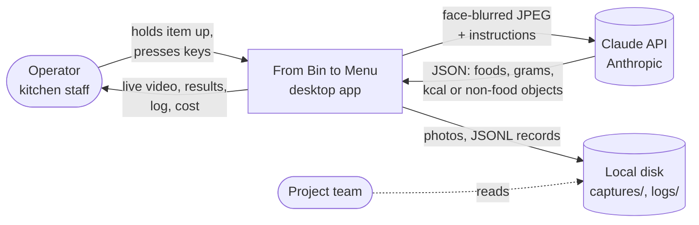
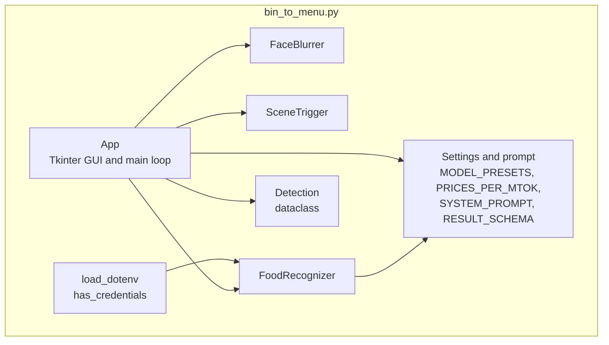
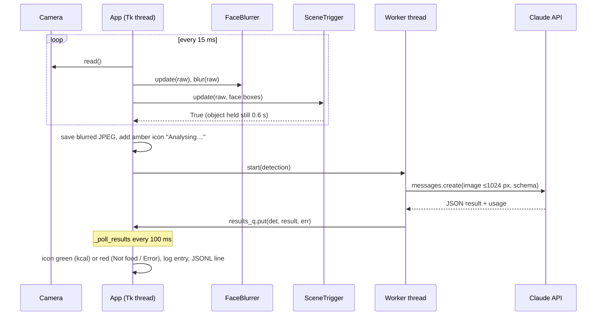
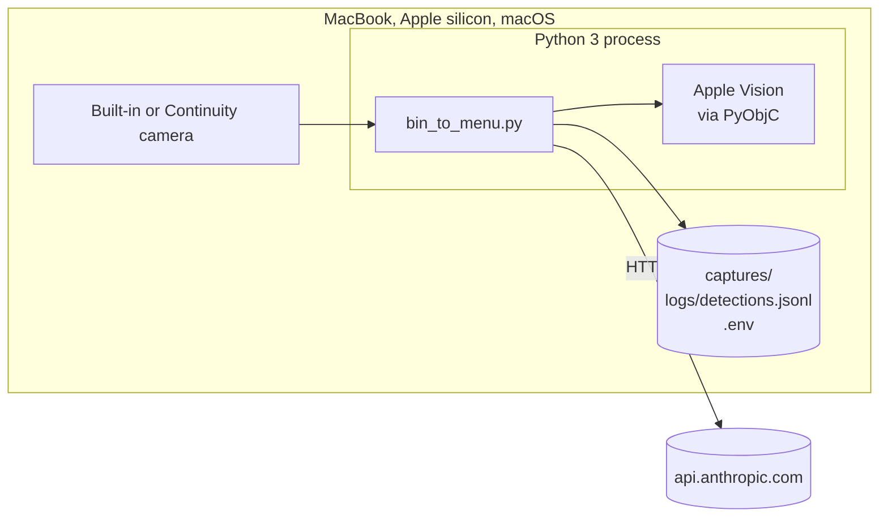

# From Bin to Menu — Architecture Documentation (arc42)

This document describes the food-waste camera (`bin_to_menu.py`, "AI Job 1 · SEE") using the [arc42](https://arc42.org) template, version 8. The user guide is in the [README](../README.md).

| | |
|---|---|
| System | From Bin to Menu — Food Waste Camera |
| Scope | The desktop application in this repository (one Python script) |
| Source of truth | `bin_to_menu.py` — when this document and the code disagree, the code wins and this document must be fixed |

Contents

1. [Introduction and Goals](#1-introduction-and-goals)
2. [Architecture Constraints](#2-architecture-constraints)
3. [Context and Scope](#3-context-and-scope)
4. [Solution Strategy](#4-solution-strategy)
5. [Building Block View](#5-building-block-view)
6. [Runtime View](#6-runtime-view)
7. [Deployment View](#7-deployment-view)
8. [Cross-cutting Concepts](#8-cross-cutting-concepts)
9. [Architecture Decisions](#9-architecture-decisions)
10. [Quality Requirements](#10-quality-requirements)
11. [Risks and Technical Debt](#11-risks-and-technical-debt)
12. [Glossary](#12-glossary)

---

## 1. Introduction and Goals

"From Bin to Menu" is a school-lunch food-waste project. Its first AI job, **SEE**, looks at what is left on trays or in the bin and turns it into data: which foods, roughly how many grams, roughly how many kcal. This application is that first job: a live camera that captures a photo whenever a new item is shown and asks Claude to identify it.

### 1.1 Requirements overview

| ID | Requirement | Where it is met |
|---|---|---|
| F1 | Open the built-in camera of a MacBook (Apple silicon, e.g. M1) and show live video | `App._open_camera`, `App._tick` |
| F2 | Take a photo automatically when a new object is held still in front of the camera; also allow a manual photo | `SceneTrigger`, `App.manual_capture` |
| F3 | Identify the food in the photo, with estimated weight (g) and energy (kcal) per item | `FoodRecognizer.analyze`, `SYSTEM_PROMPT`, `RESULT_SCHEMA` |
| F4 | Recognise food wherever it appears: tray, bin, hand, packaging, a picture of food on paper or a screen | `SYSTEM_PROMPT`, `food_source` field |
| F5 | Detect when the photo shows no food and say what it shows instead | `is_food = false`, `non_food_objects` |
| F6 | UI: main camera view, a horizontally scrolling strip of photo icons, and a log with items, grams, kcal, date and time | `App._build_ui`, `_render_strip`, `_log_detection` |
| F7 | Keep a record of every detection | `logs/detections.jsonl`, `captures/` |
| F8 | Show what each request costs and the session total | `FoodRecognizer._usage`, `App._update_status` |

### 1.2 Quality goals

| Priority | Quality goal | Scenario (see [section 10](#10-quality-requirements)) |
|---|---|---|
| 1 | **Privacy** — no recognisable face leaves the device or is stored | Q1, Q2 |
| 2 | **Usability** — hands-free; a person only holds an item up | Q3, Q4 |
| 3 | **Responsiveness** — live video never freezes while Claude is working | Q5 |
| 4 | **Cost transparency** — the user always sees what the session has cost | Q6 |
| 5 | **Plausible estimates** — grams and kcal are in a believable range (not yet calibrated) | Q7 |

### 1.3 Stakeholders

| Role | Expectation |
|---|---|
| Project team (deck owners) | A working SEE demo; data that later jobs of the project can use |
| Kitchen / lunch staff (operators) | Hold an item up, get a result, no typing |
| Students and staff in front of the camera | Their faces are not recorded or sent anywhere |
| Developers | One script that is easy to run, read and change |
| Budget holder | Low cost per photo, visible spending |

---

## 2. Architecture Constraints

| Constraint | Background |
|---|---|
| Runs on macOS on Apple silicon (MacBook M1 and newer) | The target hardware named by the project. Camera access uses AVFoundation through OpenCV. |
| Python 3, started from a terminal | No installer or app bundle; `pip3 install -r requirements.txt` then `python3 bin_to_menu.py`. |
| Recognition uses the Claude API | Needs an Anthropic API key (`ANTHROPIC_API_KEY`) and an internet connection. No local food model. |
| macOS camera permission | The terminal or editor running Python must be allowed under System Settings → Privacy & Security → Camera. |
| OpenCV below version 5 | OpenCV 5 removed `CascadeClassifier` from the main package; the Haar fallback needs it (`requirements.txt`). |
| `pyobjc-framework-Vision` on macOS only | Apple Vision exists only on macOS; other systems fall back to OpenCV. |
| Secrets stay out of git | `.env` and its variants are in `.gitignore`. |
| Captured photos and logs stay out of git | `captures/` and `logs/` are in `.gitignore` (they may show people). |

---

## 3. Context and Scope

### 3.1 Business context

| Partner | Input to the app | Output from the app |
|---|---|---|
| Operator | Items in front of the camera; keys S, Space, R, A, Q/Esc; model choice | Live video, photo icons, detection log, session cost |
| Claude API | Structured JSON result, token usage, served model | One face-blurred JPEG (longest side ≤ 1024 px) plus the system prompt |
| Local disk | — | `captures/*.jpg`, `logs/detections.jsonl` |
| Project team | — | The JSONL log for later analysis and calibration |

### 3.2 Technical context

| Channel | Technology |
|---|---|
| Camera → app | OpenCV `VideoCapture` with the AVFoundation backend, requested at 1280 × 720 |
| App → Claude | HTTPS through the `anthropic` Python SDK (Messages API), image as base64 JPEG |
| Face detection | Apple Vision (`VNDetectFaceRectanglesRequest`) through PyObjC, on the device |
| Configuration | Environment variables, or a `.env` file next to the script |
| Display | Tkinter window (Canvas, Text, ttk widgets) |

---

## 4. Solution Strategy

| Goal | Approach |
|---|---|
| Recognise any food, in any presentation, without training a model | Send the photo to a general vision model (Claude) with a detailed system prompt, and force the answer into a JSON schema (structured outputs). |
| Privacy | Blur faces on the device **before** a frame is shown, saved or sent. Apple Vision for detection, OpenCV Haar cascades as fallback. |
| Hands-free capture | Background subtraction on a small, blurred copy of each frame: an object that differs from the background and stays still for 0.6 s triggers a capture. Face regions are masked out so people moving do not trigger it. |
| Live video stays smooth | The Tk main loop only grabs, blurs and draws frames. Each Claude request runs on its own thread; results come back through a queue. |
| Cheap by default, accurate when needed | Default model Haiku 4.5; Sonnet and Opus selectable in a dropdown. Images downscaled to ≤ 1024 px. |
| Cost transparency | Compute cost per request from the token counts the API returns and a local price table. |
| Simple to run and change | One script, a few common libraries, settings as constants at the top of the file. |

---

## 5. Building Block View

### 5.1 Level 1 — the script

| Building block | Responsibility |
|---|---|
| Settings and prompt | All tunable constants: model presets, prices, detection thresholds, face-blur parameters, colours, the system prompt and the JSON result schema. |
| `load_dotenv`, `has_credentials` | Read `KEY=value` lines from `.env` (a non-empty shell variable wins) and check that a key is present. Records a status line for the log; never logs values. |
| `FaceBlurrer` | Detect faces (Apple Vision, else Haar cascades, else none), keep each box for a few frames, and pixelate it with a feathered oval mask. |
| `SceneTrigger` | Decide when to take a photo, from the difference to the background and to the previous frame. |
| `FoodRecognizer` | Build the Claude request for the chosen model, send it, check the stop reason, parse the JSON and compute the cost. |
| `Detection` | One capture: id, time, blurred frame, model, status, result, error, image path, latency, cost, tokens, thumbnail. |
| `App` | Window layout, keyboard bindings, camera start/stop, main loop, capture, worker threads, icon strip, detail window, log and JSONL writing. |

### 5.2 Level 2 — inside `App`

| Area | Methods | Notes |
|---|---|---|
| Layout | `_build_ui`, `_zoom_log` | Header with clock; resizable split (`PanedWindow`): left = video, controls, status, icon strip; right = stats, cost, log. |
| Camera | `_open_camera`, `start`, `stop`, `toggle_running`, `_show_stopped_screen` | Stop releases the camera so the green light goes off. |
| Main loop | `_tick` (every 15 ms), `_render_video`, `_update_status` | Read frame → update faces → blur → trigger → draw. |
| Capture | `manual_capture`, `_capture`, `reset_background` | Saves the blurred frame, adds an icon, starts a worker thread. |
| Recognition | `_worker`, `_poll_results` (every 100 ms) | Worker turns API errors into readable messages; the poller updates icons, log and JSONL on the Tk thread. |
| Icon strip | `_make_thumb`, `_render_strip`, `_on_new_icon`, `_on_strip_*`, `_draw_icon` | Newest icon on the right, slides in; drag, swipe or wheel to scroll back; click opens details. |
| Log | `_log_line`, `_format_result`, `_log_detection`, `_highlight_log`, `_show_detail`, `_append_jsonl` | |

### 5.3 Result schema

Claude must answer with this structure (`RESULT_SCHEMA`):

| Field | Type | Meaning |
|---|---|---|
| `is_food` | boolean | Any food in the image |
| `food_source` | `real` · `picture` · `packaged` · `none` | How the food appears |
| `summary` | string | One sentence |
| `items[]` | `name`, `estimated_grams`, `estimated_kcal`, `confidence` (`low`/`medium`/`high`) | One entry per food item |
| `total_grams`, `total_kcal` | number | Sums over `items` |
| `non_food_objects[]` | string | Main objects when there is no food |
| `notes` | string | Uncertainty and remarks |

---

## 6. Runtime View

### 6.1 Automatic capture and recognition

### 6.2 Trigger decision (`SceneTrigger.update`)

Each frame is shrunk to 320 px wide and blurred. Face boxes, enlarged by 80 %, are masked out. Then, in this order:

| Check | Result |
|---|---|
| First frame | Becomes the background |
| More than 2 % of pixels changed since the last frame | "Motion detected…", timer reset |
| Less than 1.5 % differs from the background | Scene empty: background slowly adapts to light; re-armed for the next object |
| Less than 4 % differs from the background | Nothing significant: keep monitoring |
| Less than 5 % differs from the last captured scene | "Already analysed — show a different item" |
| Less than 3 s since the last automatic capture | "Cooling down…" |
| Still for 0.6 s | **Capture** |

Manual capture (Space) skips all of these checks.

### 6.3 Model-specific requests (`FoodRecognizer.analyze`)

| Model family | Request settings |
|---|---|
| `claude-haiku*` | Structured output only (no effort setting, thinking off by default) |
| `claude-sonnet*` | Thinking disabled, effort `low`, structured output |
| `claude-opus*`, `claude-fable*` | Adaptive thinking, effort `low`, structured output, beta server-side refusal fallback |

A `refusal` or `max_tokens` stop reason is reported as an error.

### 6.4 Errors

| Situation | Shown in the log |
|---|---|
| No API key | Red banner at the top; captures skipped with a warning at most every 10 s |
| Invalid key | "API key invalid" |
| Key not scoped to a workspace | How to set `ANTHROPIC_WORKSPACE_ID` |
| Model not available to the key | "Model … is not available to this API key" |
| Rate limit, network failure, other API error | Matching message; the icon turns red with "Error" |
| Camera cannot be opened | At start: the program exits with the permission hint. After Stop → Start: log message. |

---

## 7. Deployment View

| Element | Notes |
|---|---|
| MacBook | The only machine. `--camera N` selects another camera such as an iPhone via Continuity Camera. |
| Python dependencies | `requirements.txt`: `anthropic`, `brotli`, `opencv-python<5`, `numpy`, `pillow`, `pyobjc-framework-Vision` (macOS only). Tkinter ships with Python. |
| Files next to the script | `.env` (secret, git-ignored), `captures/` and `logs/` (created on start, git-ignored). `--no-save` stops photos being written; the JSONL log is still written. |
| Anthropic API | Reached over the internet; billed per token to the key's account. |

---

## 8. Cross-cutting Concepts

### 8.1 Privacy

- Faces are tracked on every frame, even when blurring is switched off, because the trigger uses the boxes to ignore head movement.
- With **Blur faces** on (the default), the blurred frame is the only one that is displayed, saved and sent. Each face box is enlarged by 50 % and pixelated to about 7 blocks across, under a feathered oval.
- A box stays blurred for 8 frames after it was last detected, so a missed frame does not reveal a face.
- If neither Apple Vision nor Haar cascades are available, the log says "face detection: unavailable — faces are NOT blurred".
- The system prompt tells Claude to ignore blurred regions.
- `--no-save` keeps photos off the disk.

### 8.2 Configuration and secrets

- `ANTHROPIC_API_KEY` (or `ANTHROPIC_AUTH_TOKEN`), optional `ANTHROPIC_WORKSPACE_ID`, optional `BINTOMENU_MODEL` (adds a "Custom" entry to the model list and makes it the default).
- Read from the shell or from `.env`; a non-empty shell value wins. The log shows which names were loaded and their lengths, never the values.
- All other settings are constants at the top of `bin_to_menu.py`.

### 8.3 Concurrency

- Tkinter is single-threaded: every widget update runs on the main thread.
- Each capture starts one daemon worker thread that only calls the API and puts its result on `results_q`. `_poll_results` drains the queue on the main thread.

### 8.4 Cost accounting

- `cost = input_tokens × input price + output_tokens × output price`, using `PRICES_PER_MTOK` (US$ per million tokens). Input tokens include cache-creation and cache-read tokens. Thinking tokens are billed as output.
- The price is looked up by the model that served the response, falling back to the requested model.
- Shown per log entry and as "This session"; stored in each JSONL record. There is no API for the remaining credit balance.

### 8.5 Persistence

- Photos: `captures/YYYYMMDD_HHMMSS_<id>.jpg` (face-blurred).
- `logs/detections.jsonl`: one JSON object per finished detection — `id`, `timestamp`, `status` (`food`/`nonfood`/`error`), `image`, `result`, `error`, `model`, `latency_s`, `cost_usd`, `tokens`.
- Detection ids restart at 1 on every launch; use `timestamp` together with `id` as the key.

### 8.6 User interface

- Dark theme; colour carries meaning: green = food, red = not food or error, amber = pending or progress, blue = time.
- An amber bar under the video shows hold-still progress; a white flash marks a capture.
- Log text size: A− / A+ buttons or ⌘− / ⌘+.

---

## 9. Architecture Decisions

| # | Decision | Reason | Consequence |
|---|---|---|---|
| AD-1 | Use Claude (cloud vision model) rather than a local food classifier | Recognises any food and any presentation, and names items specifically, without collecting training data | Needs internet and an API key; costs money per photo; estimates are visual only |
| AD-2 | Force the answer into a JSON schema (structured outputs) | Results can be parsed and logged without fragile text parsing | The schema and the prompt must be changed together |
| AD-3 | Blur faces on the device before display, storage and upload | Privacy is the top quality goal; people stand in front of the camera | Extra processing per frame; depends on Apple Vision for good recall |
| AD-4 | Apple Vision first, Haar cascades as fallback | Vision handles glasses, tilted and partly turned faces far better | macOS-only dependency; OpenCV kept below 5 for the fallback |
| AD-5 | Background subtraction plus a stillness timer as the trigger | Cheap, needs no model, works on any object | Lighting changes and a moving background need a reset (R); see AD-6 |
| AD-6 | Mask face regions out of the trigger | A person sitting in front of the camera must not cause captures | Food held right in front of a face may be partly ignored by the trigger |
| AD-7 | Haiku 4.5 as the default model | Cheapest and fastest; good enough for a demo | Less accurate than Sonnet or Opus; switchable in the dropdown |
| AD-8 | Different request settings per model family | Each family supports different thinking and effort options; low effort keeps latency down | Adding a model family needs a new branch in `analyze` |
| AD-9 | One worker thread per capture, results via a queue | Live video never waits for the network | Many quick captures mean many parallel requests |
| AD-10 | Cost computed from returned token counts and a local price table | Exact per request without another API | Prices must be updated by hand when they change |
| AD-11 | One script, Tkinter UI | Nothing to install beyond pip packages; easy to read for the project team | The file is large (~1,000 lines); no automated tests yet |
| AD-12 | JSON Lines log | Append-only, one record per line, easy to load into a spreadsheet or pandas | No database or query tool |

---

## 10. Quality Requirements

### 10.1 Quality tree

| Quality | Sub-goal | Scenarios |
|---|---|---|
| Privacy | No face leaves the device; no face on disk | Q1, Q2 |
| Usability | Hands-free capture; no false captures from people | Q3, Q4 |
| Performance | Smooth video; known response time | Q5 |
| Cost transparency | Session cost always visible | Q6 |
| Accuracy | Plausible grams and kcal; correct food / non-food decision | Q7, Q8 |

### 10.2 Quality scenarios

| ID | Scenario | Expected response |
|---|---|---|
| Q1 | A student's face is in the frame when a photo is taken | The saved JPEG and the image sent to Claude show the face pixelated |
| Q2 | Apple Vision misses a face for one frame | The previous box is kept for up to 8 frames, so the face stays blurred |
| Q3 | An operator holds a tray still in front of the empty scene | A photo is taken after about 0.6 s without a key press |
| Q4 | A person sits in front of the camera and moves their head | No capture is triggered |
| Q5 | Claude takes several seconds to answer | Video keeps running; the log shows the response time (2.6–6.3 s with Haiku 4.5 in the README samples) |
| Q6 | The operator wants to know what the session has cost | "This session: US$…" is always visible; about US$0.0024–0.0040 per photo with Haiku 4.5 in the samples |
| Q7 | A plate of food is analysed | Grams and kcal per item are in a believable range. **Not yet verified** — calibration against a kitchen scale is planned for Weeks 1–3 (deck slide 7) |
| Q8 | A stapler is shown | The result is "NOT FOOD" and names the stapler |

---

## 11. Risks and Technical Debt

| # | Risk or debt | Impact | Mitigation / next step |
|---|---|---|---|
| R-1 | Gram and kcal estimates are not calibrated | Data may be wrong by a large factor (piles of produce are hard to judge from one angle) | Weeks 1–3: compare with a kitchen scale; adjust the prompt or add a reference object |
| R-2 | `food_source` is unreliable: a sharp photo of a real tray can be labelled "picture" (README sample 5) | Real-vs-picture statistics are untrustworthy | Do not use `food_source` for reporting until it is checked; improve the prompt |
| R-3 | Face blurring depends on detection | A missed face would be saved and sent | Apple Vision plus hold frames; check the log for "faces are NOT blurred" |
| R-4 | Depends on the Claude API, the network and the account balance | No results offline or when credit runs out | Errors are shown in the log; captures stay on disk |
| R-5 | Model ids and prices are hard-coded | Wrong costs or "model not available" after changes | Update `MODEL_PRESETS` and `PRICES_PER_MTOK` together; `BINTOMENU_MODEL` for a quick override |
| D-1 | No automated tests | Changes can break the trigger or parsing unnoticed | Add tests for `SceneTrigger`, `_format_result`, `_usage`, `load_dotenv` |
| D-2 | No way to feed a still image or video file instead of the camera | Results (e.g. the README samples) cannot be reproduced by others | Add an `--image` / `--video` option |
| D-3 | Everything is in one ~1,000-line file | Harder to change as features grow | Split into modules when a second job (e.g. the menu side) is added |
| D-4 | Unbounded worker threads | Many fast manual captures send many parallel requests | Limit concurrent requests if this becomes a problem |
| D-5 | Detection ids restart every launch | Ids alone are not unique in the JSONL log | Use `timestamp` with `id`, or persist a counter |

---

## 12. Glossary

| Term | Meaning |
|---|---|
| AI Job 1 · SEE | The first AI task of the From Bin to Menu project: see the waste and turn it into data |
| Background | The image of the empty scene that new objects are compared with; reset with R |
| Capture | One photo taken automatically or with Space; becomes a `Detection` |
| Detection | One capture and its result, shown as an icon and a log entry |
| Food source | How food appears: `real`, `picture` (photo or screen), `packaged`, or `none` |
| Hold still | The scene must not change for 0.6 s before an automatic capture |
| Icon strip | The row of photo thumbnails under the video; newest on the right |
| JSONL | JSON Lines: one JSON object per line, used for `logs/detections.jsonl` |
| kcal | Kilocalories, the energy estimate per item |
| Model preset | An entry in the Model dropdown: Fast · Haiku 4.5, Balanced · Sonnet 5, Accurate · Opus 5 |
| Structured outputs | Claude API feature that makes the reply match a given JSON schema |
| Token | The unit the Claude API bills by; images and text are both counted in tokens |
